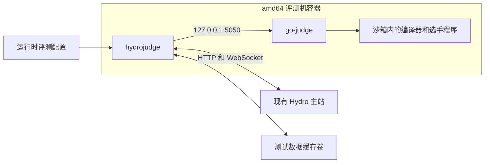

# Hydro 独立评测机 amd64 镜像研究

研究日期：2026 年 10 月 27 日

目标平台：`linux/amd64`

阶段：方案研究，镜像构建和真实评测尚未开展

Hydro 可以作为独立评测机运行，因此可以制作一个连接现有 Hydro 主站的 Docker 镜像。建议沿用官方安装脚本的 Nix 工具链和沙箱挂载方式，将软件安装安排在镜像构建阶段，将账号配置、资源检查和服务启动安排在容器运行阶段。

首版采用单容器方案，同时运行评测客户端 `hydrojudge` 和沙箱服务 `go-judge`。仅支持 amd64，不安排 ARM64 适配或多架构构建。

## 一 评测机的组成和通信方式

独立评测机由以下部分组成。

| 组件 | 职责 |
| --- | --- |
| `@hydrooj/hydrojudge` | 登录主站，接收任务，获取代码和测试数据，组织评测并回传结果 |
| `go-judge` | 提供沙箱接口，在受资源限制的环境中执行编译器和选手程序 |
| 编译器及运行时 | 支持 C、C++、Python 等语言 |
| 基础工具 | 为编译、检查器和运行脚本提供 Bash、coreutils、diffutils 等工具 |

官方脚本将 `go-judge` 链接为 `hydro-sandbox`，两者在这里指同一个沙箱服务。独立评测机无需安装 Hydro 网页端、MongoDB 或 Caddy。[安装脚本源码](https://github.com/hydro-dev/Hydro/blob/f5c2ac14e182b8f1238b1ee1a6e78e4fb0fdd816/install/install.ts)



`hydrojudge` 主动连接主站的 `/judge/conn` WebSocket 接口，通过 HTTP 获取评测文件并上传结果相关文件。通常无需向宿主机发布评测机端口；沙箱只需在容器内部监听 `127.0.0.1:5050`。评测机还需要能够访问主站返回的文件下载地址。[主站连接实现](https://github.com/hydro-dev/Hydro/blob/f5c2ac14e182b8f1238b1ee1a6e78e4fb0fdd816/packages/hydrojudge/src/hosts/hydro.ts)

主站需要准备具有 `PRIV_JUDGE` 权限的专用账号。账号信息由容器运行时提供，不写入镜像层。[独立评测机说明](https://docs.hydro.ac/zh/docs/Hydro/plugins/hydrojudge)、[主站接口权限](https://github.com/hydro-dev/Hydro/blob/f5c2ac14e182b8f1238b1ee1a6e78e4fb0fdd816/packages/hydrooj/src/handler/judge.ts)

## 二 官方安装脚本的行为

研究入口为：

```bash
LANG=zh . <(curl https://hydro.ac/setup.sh) --judge
```

当前获取到的外层安装脚本版本为 `v3.0.1`。它先安装 Nix 和 Node.js，再解压内嵌的 JavaScript 安装程序，执行评测机安装流程。[外层安装脚本](https://hydro.ac/setup.sh)、[Nix 安装脚本](https://hydro.ac/nix.sh)

`--judge` 模式的主要行为如下。

| 步骤 | 行为 |
| --- | --- |
| 环境准备 | 检查 root、系统和共享内存等条件，配置 Nix 和包下载源 |
| 基础软件 | 安装 PM2、Yarn、Bash、压缩解压及文本处理工具 |
| 语言环境 | 安装 GCC 和 Python 3 |
| 沙箱安装 | 安装 `go-judge`，建立 `hydro-sandbox` 链接 |
| 客户端安装 | 安装 `@hydrooj/hydrojudge`，生成 `~/.hydro/judge.yaml` |
| 服务准备 | 生成沙箱挂载配置，启动沙箱，保存 PM2 进程配置 |
| 系统配置 | 设置 PM2 开机启动，修改系统参数，配置日志轮转 |
| 后续操作 | 提示用户编辑评测配置，再启动 `hydrojudge` |

其中的系统配置和服务管理面向普通 Linux 服务器。镜像构建应提取软件安装与环境生成步骤，容器启动时再管理两个服务，避免在 Dockerfile 中原样执行完整安装流程。[安装流程源码](https://github.com/hydro-dev/Hydro/blob/f5c2ac14e182b8f1238b1ee1a6e78e4fb0fdd816/install/install.ts)

原样使用脚本还有以下实施问题：

- `pm2 startup` 依赖服务器启动管理方式，常规容器中未必适用。
- 构建期间启动的后台进程不能代替容器的运行入口。
- 并发配置会参考安装时的 CPU 数量，不应直接沿用构建机的资源信息。
- 安装源和依赖会变化，需要另行固定版本与依赖锁文件。
- 文档要求在 Docker 内执行安装脚本时设置 `USER=root`；命令中的进程替换语法还需要 Bash 等支持，不能直接依赖 Docker 默认的 `/bin/sh`。[Docker 安装注意事项](https://docs.hydro.ac/zh/docs/Hydro/install)

## 三 上游 Docker 示例的参考价值

Hydro 主仓库已有 `install/docker/judge` 示例，其 README 注明该模块非官方维护，不提供技术支持。[上游 Docker 说明](https://github.com/hydro-dev/Hydro/blob/f5c2ac14e182b8f1238b1ee1a6e78e4fb0fdd816/install/docker/README.md)

示例使用 `node:22`，通过 apt 安装多种语言工具，再安装 PM2 和 `@hydrooj/hydrojudge`。入口脚本先启动沙箱，再通过 `pm2-runtime` 运行评测客户端；Compose 为评测容器开启 `privileged`，并挂载配置文件。[Dockerfile](https://github.com/hydro-dev/Hydro/blob/f5c2ac14e182b8f1238b1ee1a6e78e4fb0fdd816/install/docker/judge/Dockerfile)、[入口脚本](https://github.com/hydro-dev/Hydro/blob/f5c2ac14e182b8f1238b1ee1a6e78e4fb0fdd816/install/docker/judge/entrypoint.sh)、[Compose 配置](https://github.com/hydro-dev/Hydro/blob/f5c2ac14e182b8f1238b1ee1a6e78e4fb0fdd816/install/docker/docker-compose.yml)

该示例可以参考进程组成和部署方式，但需要重新处理以下部分：

1. 沙箱固定为 `1.9.4` 的 `amd64v3` 二进制，应改为所选版本的普通 amd64 构建。
2. 客户端未固定安装版本，需要补充依赖锁定。
3. 入口缺少显式的沙箱就绪等待和配置校验。
4. Compose 未显式设置共享内存容量，也未持久化测试数据缓存。
5. apt 工具链与当前官方脚本使用的 Nix 环境存在差异，需要单独验证编译路径和语言行为。

amd64 不等于 amd64v3。Go 的 v3 构建要求 AVX2、BMI 等额外指令；普通 amd64 构建更适合作为通用镜像的默认选项。`go-judge 1.13.3` 的发布构建配置同时包含 v1 和 v3。[Go 微架构要求](https://go.dev/wiki/MinimumRequirements#amd64)、[沙箱发布构建配置](https://github.com/criyle/go-judge/blob/v1.13.3/.goreleaser.yaml)

## 四 镜像实现方案

### 技术路线比较

| 路线 | 优点 | 需要处理的问题 | 结论 |
| --- | --- | --- | --- |
| 原样执行完整安装脚本 | 接近服务器安装流程 | 启动管理、系统配置、资源探测及依赖漂移不适合镜像构建 | 不作为正式构建方式 |
| Debian 和 apt 工具链 | 结构直接，上游已有容器示例 | 语言版本及沙箱挂载需要单独维护和验证 | 可作为备选方案 |
| Debian 和固定版本的 Nix 环境 | 接近官方当前评测环境，便于明确工具链版本 | 需要维护 Nix 版本锁定和运行环境闭包 | 建议采用 |

### 首版建议

| 项目 | 方案 |
| --- | --- |
| 平台 | 仅 `linux/amd64` |
| 基础系统 | Debian 12，并固定基础镜像摘要 |
| Node.js | 先以 22 系列作为候选，与上游 Docker 示例一致，构建时固定具体版本 |
| 语言范围 | 首版 C、C++、Python 3；Java、Go、Rust 等后续按需求增加 |
| 工具链管理 | 固定 Nixpkgs 修订和所用包，保留完整运行依赖 |
| 客户端 | 固定 `@hydrooj/hydrojudge` 版本及传递依赖 |
| 沙箱 | 固定普通 amd64 二进制版本并校验 SHA256 |
| 进程管理 | 前台管理两个进程，输出容器日志，传递停止信号并清理子进程 |
| 配置 | 只读挂载 `judge.yaml`；可由入口将环境变量或 secret 文件转换为运行配置 |
| 数据 | 使用独立持久卷保存测试数据缓存 |
| 更新 | 重建并替换镜像，保留可回退的版本标签 |

截至研究日期，npm 发布的 `@hydrooj/hydrojudge` 为 `4.0.6`，`go-judge` 最新发布版本为 `1.13.3`。两者可作为首轮验证的候选版本，组合兼容性由后续构建与真实评测确认。[npm 发布信息](https://registry.npmjs.org/@hydrooj%2fhydrojudge/latest)、[沙箱发布页](https://github.com/criyle/go-judge/releases/tag/v1.13.3)

镜像内不保存主站密码、实际评测数据或固定认证 secret；也不按构建机 CPU 数量生成最终并发配置。

## 五 配置和文件布局

建议区分配置、测试数据缓存和临时数据。

| 路径 | 用途 | 保存方式 |
| --- | --- | --- |
| `/config/judge.yaml` | 主站地址、账号、并发数和评测限制 | 运行时只读挂载 |
| `/opt/hydrojudge/mount.yaml` | 沙箱文件系统配置 | 随镜像发布，可按需覆盖 |
| `/var/cache/hydrojudge` | 测试数据缓存 | 独立持久卷 |
| `/tmp/hydrojudge` | 当前任务临时文件 | 容器临时存储 |
| `/nix/store` 及工具链环境 | 编译器、基础工具和运行依赖 | 随镜像发布 |

`hydrojudge` 支持通过 `CONFIG_FILE` 指定配置文件。当前代码优先读取 `~/.hydro/judge.yaml`，同时兼容旧的 `~/.config/hydro/judge.yaml`；显式指定文件可以避免路径混淆。[配置读取实现](https://github.com/hydro-dev/Hydro/blob/f5c2ac14e182b8f1238b1ee1a6e78e4fb0fdd816/packages/hydrojudge/src/config.ts)

下面是首轮验证可采用的配置示意，资源参数需要按宿主机和题目要求调整。

```yaml
hosts:
  main:
    type: hydro
    server_url: https://oj.example.com/
    uname: judge
    password: REPLACE_AT_RUNTIME
    detail: full
    concurrency: 2

sandbox_host: http://127.0.0.1:5050
cache_dir: /var/cache/hydrojudge
tmp_dir: /tmp/hydrojudge
parallelism: 2
singleTaskParallelism: 2
memoryMax: 1024m
processLimit: 128
```

上述账号、地址和资源值均为示例。`hosts.main.concurrency` 与评测客户端的 `parallelism`、沙箱的执行并发分别控制不同环节，应一起核对，不能只修改其中一项。

## 六 沙箱和宿主机要求

### 权限和 cgroup

首版按官方要求以 root 运行，并在 Compose 中设置 `privileged: true`。沙箱需要创建隔离环境并配置 cgroup 资源限制，后续通过真实任务确认权限和限制是否生效。[Hydro 安装要求](https://docs.hydro.ac/zh/docs/Hydro/install)、[go-judge 运行要求](https://github.com/criyle/go-judge/blob/4ebd2ffe9474639c665fa21cfb438f68820fe77c/README.md)

采用 cgroup v2 时，建议宿主机内核至少为 Linux 5.19，以使用 `memory.peak` 计量峰值内存。应检查沙箱 `/config` 返回的 cgroup 类型和控制器，确保 memory 控制器开启，并实际验证内存和进程数限制。

可考虑启用 `go-judge -no-fallback`，在 cgroup 配置失败时直接退出，避免静默退回限制能力不同的模式；该参数不能代替对各个控制器的检查。[沙箱参数说明](https://docs.goj.ac/configuration)

### 共享内存和临时空间

需要显式配置容器的 `shm_size`。首轮可以从 `1 GiB` 开始测试，再结合任务并发、编译产物和输出规模调整；该数值是验证起点，不是通用最低配置。

同时要区分以下三类空间：

- `/dev/shm`：沙箱文件存储默认使用的共享内存。
- 沙箱内 `/w` 和 `/tmp` 的 tmpfs：由 `mount.yaml` 中的大小和 inode 数量控制。
- 评测客户端测试数据缓存：需要持久化的磁盘数据。

扩大 `shm_size` 不会自动扩大 `/w` 或 `/tmp`。还应保持适当的栈限制，并用递归程序、大文件读写和并发编译验证配置。[沙箱挂载说明](https://docs.goj.ac/mount)、[评测机空间和栈设置](https://docs.hydro.ac/zh/docs/Hydro/plugins/hydrojudge)

### 编译器必须在沙箱内可用

官方 Nix 方案会将工具链环境的 `bin`、`lib` 等目录映射到沙箱，同时提供 `/nix`。仅在外层容器中执行 `gcc --version`，不足以证明评测环境可用。

镜像验收应在沙箱内完成编译、运行和检查器测试；编译路径还要与主站下发的语言配置一致。官方文档提供了用 `nix-build` 生成独立评测 rootfs 的方法，可以作为固定工具链环境的实现参考。[编译器和语言说明](https://docs.hydro.ac/zh/docs/Hydro/install/compiler)

### 启动和健康检查

建议入口按以下顺序执行：

1. 检查配置是否存在，拒绝示例密码和缺失的主站地址。
2. 检查运行权限、缓存目录及资源参数。
3. 启动沙箱，等待 `/version` 和 `/config` 可用。
4. 核对沙箱版本、cgroup 控制器及必要能力。
5. 启动 `hydrojudge`，完成登录及 WebSocket 连接。
6. 在任一关键进程退出时明确处理故障，停止时清理两个进程。

健康检查应区分沙箱可执行程序与评测客户端已连接主站两种状态。只检测进程存在或沙箱 HTTP 响应，不能证明主站任务可以完成。

## 七 后续实现与验收

### 拟交付文件

| 文件 | 内容 |
| --- | --- |
| `Dockerfile` | amd64 镜像构建步骤及依赖锁定 |
| `docker-compose.yml` | 权限、共享内存、缓存卷、重启策略及配置挂载 |
| `entrypoint` | 配置检查、沙箱就绪等待、进程管理和退出处理 |
| `judge.yaml.example` | 不含真实凭据的配置示例 |
| `mount.yaml` | 与 Nix 工具链一致的沙箱挂载配置 |
| Nix 配置及锁定文件 | 工具链组成和版本 |
| `README.md` | 部署、配置、升级、缓存清理与排错说明 |

### 验收清单

以下项目均为待验证，不能以镜像构建成功或容器保持运行替代。

| 范围 | 验收内容 |
| --- | --- |
| amd64 构建 | 在原生 amd64 环境构建和运行，确认基础镜像与沙箱架构匹配 |
| 启动 | 检查有效配置、缺失配置、错误密码和不可达主站时的行为 |
| 主站连接 | 专用账号登录成功，建立 WebSocket，主站可见评测机状态 |
| 基础语言 | 在沙箱内验证 C、C++、Python 3 的编译或执行 |
| 基本结果 | 使用已知程序分别验证 AC、WA、CE 和 RE |
| 资源限制 | 验证 TLE、MLE、进程数限制和输出限制，避免误判为系统错误 |
| 题型 | 验证普通题、文件 IO、特殊判题和交互题 |
| 文件传输 | 验证测试数据、代码、编译产物和结果相关文件的完整流程 |
| 并发 | 验证持续多任务评测、资源占用、任务完成和清理情况 |
| 重连 | 验证主站重启、网络中断后的恢复行为 |
| 持久化 | 重建容器后缓存仍可复用，清理命令可正常工作 |
| 生命周期 | 验证停止、重启、关键进程异常和日志输出 |
| 发布 | 记录客户端、沙箱、工具链和镜像版本，保留镜像摘要及回退方式 |

最终需要在实际使用的 amd64 Linux 宿主机上完成代表性评测，才能确定镜像可交付。其他架构上的模拟运行不能作为时间和内存计量的验收依据。

## 八 研究基线

上文 Hydro 源码链接固定到提交 `f5c2ac14e182b8f1238b1ee1a6e78e4fb0fdd816`，沙箱发布候选为 `v1.13.3`。正式构建前应再次核对发布信息，然后将选定版本固定到构建配置。

本轮下载内容的 SHA256 如下，用于标识研究时读取的具体文件。

| 内容 | SHA256 |
| --- | --- |
| `https://hydro.ac/setup.sh` | `56e0f90cefa2f56b5710721e5480e8fa4027d76f2705fc4cb097fe538cd84780` |
| `https://hydro.ac/nix.sh` | `7d3ab78256a08bb22a41a53116d45cfff4819afd404645b5cd6a77994d8d76e3` |
| npm `hydrojudge-4.0.6.tgz` | `f047f11292756e12d6ae7b87c560d11f35cb900e1454c7e673edbaa1c5d4bf5f` |

这些哈希标识研究样本。构建时还需要对实际下载的沙箱二进制、基础镜像和依赖分别固定版本并完成校验。
